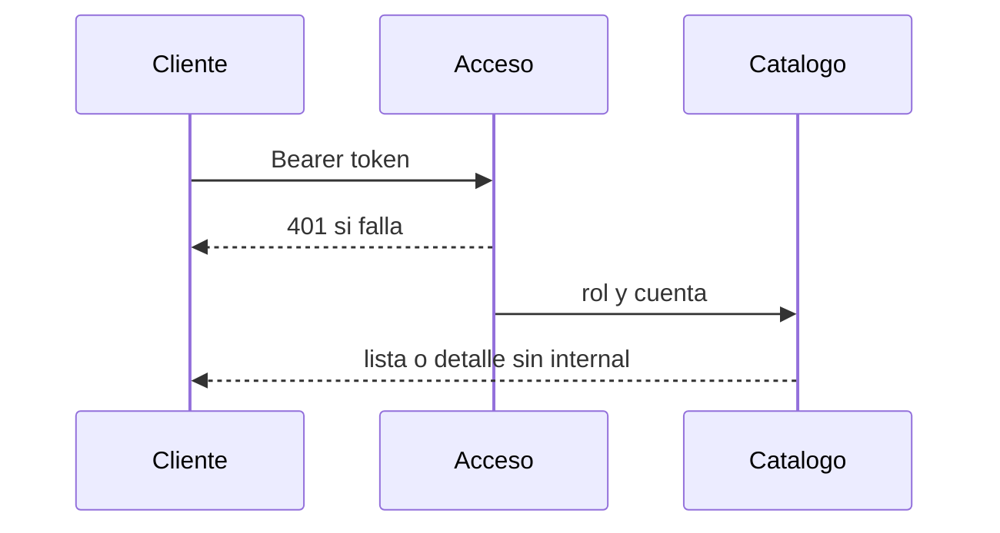

# Especificación de la API

Servidor Node 18 con Express. Lee el kit. No hay base de datos.

## GET /api/projects

200. Lista de `{ id, name, address, status, clientName }` de los proyectos visibles. Lista vacía si no hay ninguno. `clientName` es `client.name`.

## GET /api/projects/:id

200 con `id`, `name`, `address`, `status`, `clientName`, `dates`, `levels`, `contacts`. Fechas `null` se envían como `null`; la página muestra `Not recorded`. Contactos: staff incluye `email` y `phone`; client solo `role` y `name`. ETag y `Cache-Control: private, no-store`. 304 si `If-None-Match` coincide.

## GET /api/projects/:id/spaces

200 con la lista de cajas: `id`, `name`, `use`, `level`, `x`, `y`, `z`, `w`, `d`, `h`. 404 si el archivo no existe.

## GET /api/projects/:id/cloud

200 el binario completo, o 206 si hay `Range`. 404 si no hay nube.

## POST /api/projects/:id/issues

Cuerpo `{ "title", "level", "spaceId"? }`. 201 `{ "id" }`.

## Errores

| Caso | Código | Cuerpo |
|---|---|---|
| Sin token o token inválido | 401 | `{ "error": "Unauthorized" }` |
| No visible o no existe | 404 | `{ "error": "Not found" }` |
| Validación o JSON roto | 400 | `{ "error": "<motivo corto en inglés>" }` |
| Rango imposible | 416 | `{ "error": "Range not satisfiable" }` |

## Sources
