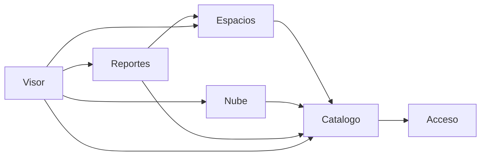

# Componentes — Site Viewer Lite

```yaml
components:
  - name: Acceso
    summary: Resuelve el token y el rol de quien llama.
    behaviour: >
      Cada petición trae Authorization Bearer. Sin token o con token desconocido
      responde 401. staff ve todo. client solo ve la cuenta que le corresponde.
    responsibilities:
      - Leer data/users.json
      - Decidir si la petición sigue o se corta con 401
    depends_on: []
    dependents:
      - component: Catalogo
        interaction: el catálogo pregunta quién es antes de listar
        style: sync
    external_dependencies:
      - name: users.json
        kind: other
        purpose: tres usuarios del kit, con token y rol
    entities:
      - name: Usuario
        identifier: token
        attributes: [token, nombre, rol, cuenta]

  - name: Catalogo
    summary: Proyectos visibles, sin el bloque interno.
    behaviour: >
      Lista y detalle según el rol. El bloque internal nunca sale. Un cliente
      no recibe correo ni teléfono. Un proyecto ajeno responde igual que uno
      inexistente. El detalle lleva ETag por usuario y no entra en cachés compartidas.
    responsibilities:
      - Leer data/projects.json
      - Quitar internal y, para client, correo y teléfono
      - Responder 304 cuando el ETag coincide
    depends_on:
      - component: Acceso
        interaction: saber rol y cuenta
        style: sync
    dependents:
      - component: Espacios
        interaction: confirmar que el proyecto es visible
        style: sync
      - component: Nube
        interaction: confirmar que el proyecto es visible
        style: sync
      - component: Reportes
        interaction: confirmar que el proyecto es visible y que el nivel existe
        style: sync
      - component: Visor
        interaction: lista y ficha
        style: sync
    external_dependencies:
      - name: projects.json
        kind: other
        purpose: tres proyectos del kit
    entities:
      - name: Proyecto
        identifier: id
        attributes: [id, nombre, direccion, estado, fechas, niveles, cuenta, cliente, internal]
      - name: Contacto
        identifier: nombre
        attributes: [rol, nombre, correo, telefono]

  - name: Espacios
    summary: Cuartos del proyecto como cajas.
    behaviour: >
      Devuelve los cuartos solo si Catalogo deja ver el proyecto. Si el archivo
      no existe, 404. No lee fuera de data/spaces.
    responsibilities:
      - Leer data/spaces/<id>.json
    depends_on:
      - component: Catalogo
        interaction: el proyecto tiene que ser visible
        style: sync
    dependents:
      - component: Reportes
        interaction: spaceId, si viene, tiene que ser un cuarto de ese proyecto
        style: sync
      - component: Visor
        interaction: dibujar las cajas
        style: sync
    external_dependencies:
      - name: spaces
        kind: other
        purpose: un JSON de cajas por proyecto
    entities:
      - name: Espacio
        identifier: id
        attributes: [id, nombre, uso, nivel, x, y, z, w, d, h]
        references:
          - entity: Proyecto
            owned_by: Catalogo
            relationship: cada espacio pertenece a un proyecto

  - name: Nube
    summary: Archivo binario PTS1 con rangos.
    behaviour: >
      Sirve el archivo del proyecto visible. Range bytes=0-15 responde 206 con
      16 bytes. Sin nube, 404. Rango imposible, 416. No sirve un archivo a medias
      como si estuviera completo.
    responsibilities:
      - Leer data/clouds/<id>.pts
      - Responder rangos
    depends_on:
      - component: Catalogo
        interaction: el proyecto tiene que ser visible
        style: sync
    dependents:
      - component: Visor
        interaction: descargar y dibujar puntos
        style: sync
    external_dependencies:
      - name: nubes PTS1
        kind: other
        purpose: binario que genera tools/make-cloud.js
    entities:
      - name: ArchivoNube
        identifier: idProyecto
        attributes: [ruta, tamano]

  - name: Reportes
    summary: Crea un reporte y lo guarda en JSON.
    behaviour: >
      Título de 1 a 120 caracteres. El nivel existe en el proyecto. spaceId, si
      viene, es un espacio de ese proyecto. JSON roto o cuerpo inválido es 4xx,
      nunca 500. La escritura es atómica. Dos reportes no comparten id.
    responsibilities:
      - Validar el cuerpo
      - Agregar el reporte a data/issues.json
    depends_on:
      - component: Catalogo
        interaction: proyecto visible y nivel válido
        style: sync
      - component: Espacios
        interaction: spaceId opcional debe existir
        style: sync
    dependents:
      - component: Visor
        interaction: enviar el formulario
        style: sync
    external_dependencies:
      - name: issues.json
        kind: other
        purpose: archivo local de reportes
    entities:
      - name: Reporte
        identifier: id
        attributes: [id, titulo, nivel, idEspacio, idProyecto]
        references:
          - entity: Proyecto
            owned_by: Catalogo
            relationship: cada reporte es de un proyecto
          - entity: Espacio
            owned_by: Espacios
            relationship: el espacio es opcional

  - name: Visor
    summary: La única página, en inglés.
    behaviour: >
      Selector staff, acme, brick. Lista, ficha, cajas, filtro, unidad, nube con
      progreso y cancelación, formulario. Cambiar de token o de proyecto cancela
      la descarga. Un error muestra Try again. No usa alert ni prompt.
    responsibilities:
      - Presentar la página
      - Cancelar descargas al cambiar de contexto
    depends_on:
      - component: Catalogo
        interaction: lista y ficha
        style: sync
      - component: Espacios
        interaction: cajas
        style: sync
      - component: Nube
        interaction: archivo de puntos
        style: sync
      - component: Reportes
        interaction: crear reporte
        style: sync
    dependents: []
    external_dependencies:
      - name: three.js
        kind: third-party-api
        purpose: escena, órbita y THREE.Points
    entities: []
```

## Component Diagram



La flecha sale de quien llama y llega a quien responde.

## Component Summary

| Component | Purpose | Depends On | Dependents | Entities Owned |
|---|---|---|---|---|
| Acceso | Token y rol | — | Catalogo | Usuario |
| Catalogo | Proyectos sin datos internos | Acceso | Espacios, Nube, Reportes, Visor | Proyecto, Contacto |
| Espacios | Cajas | Catalogo | Reportes, Visor | Espacio |
| Nube | PTS1 con rangos | Catalogo | Visor | ArchivoNube |
| Reportes | Alta de reportes | Catalogo, Espacios | Visor | Reporte |
| Visor | Página única | Catalogo, Espacios, Nube, Reportes | — | — |

## Entity Ownership

| Entity | Owning Component | Identifier | Attributes | References |
|---|---|---|---|---|
| Usuario | Acceso | token | token, nombre, rol, cuenta | — |
| Proyecto | Catalogo | id | id, nombre, direccion, estado, fechas, niveles, cuenta, cliente, internal | — |
| Contacto | Catalogo | nombre | rol, nombre, correo, telefono | Proyecto |
| Espacio | Espacios | id | id, nombre, uso, nivel, x, y, z, w, d, h | Proyecto |
| ArchivoNube | Nube | idProyecto | ruta, tamano | — |
| Reporte | Reportes | id | id, titulo, nivel, idEspacio, idProyecto | Proyecto, Espacio |

## External Dependencies

| Component | Dependency | Kind | Purpose |
|---|---|---|---|
| Acceso | users.json | other | Usuarios del kit |
| Catalogo | projects.json | other | Proyectos del kit |
| Espacios | spaces | other | Cajas por proyecto |
| Nube | nubes PTS1 | other | Binario del generador |
| Reportes | issues.json | other | Reportes locales |
| Visor | three.js | third-party-api | Escena 3D |

## Rationale

Una sola descomposición es viable: cada bloque posee un archivo distinto y una regla distinta (quién entra, qué se oculta, cajas, binario, reportes, página). Juntar el binario con el JSON de proyectos mezclaría un archivo grande y con rangos con datos que nunca deben filtrarse. El Visor no posee datos: si se cae la red, los archivos del kit siguen siendo la fuente.

## Sources
