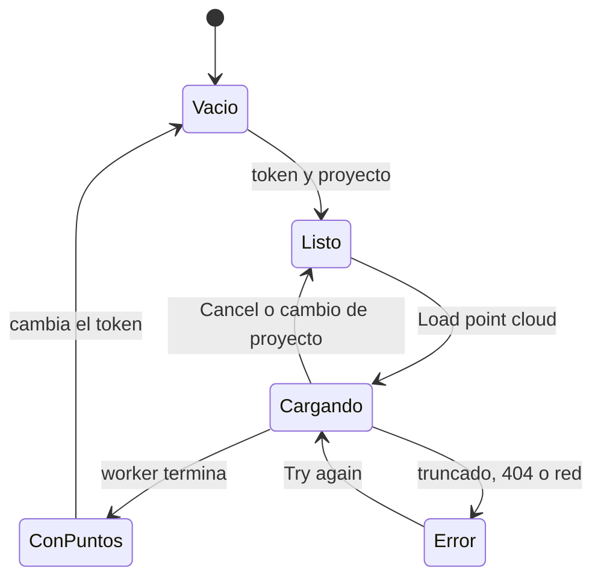

# Especificación del visor

Una página en inglés. El selector ofrece `staff`, `acme` y `brick`, que envían `staff-token`, `acme-token` y `brick-token`.

## Flujo

1. Al elegir token se pide `GET /api/projects` y se limpia ficha, escena, error y descarga (BR7.1).
2. Al elegir un proyecto se pide el detalle y los espacios. Una fecha null se escribe `Not recorded` (BR3.5).
3. Cada espacio es una caja. La esquina mínima es `(x, y, z)` en metros, Z hacia arriba, y el tamaño es `(w, d, h)`. Un color por nivel.
4. Ratón y dedos orbitan, acercan y desplazan. Tocar una caja abre el panel con nombre, uso, nivel y área. Sin toque, el panel no nombra un cuarto (BR8.1).
5. El área en m² es `w * d`. En ft² se multiplica por 10.7639 y se muestra un decimal. Un botón alterna la unidad.
6. El filtro de nivel oculta las demás cajas. «All levels» las devuelve.
7. `Load point cloud` descarga con `Range` por tramos, parsea PTS1 en un Web Worker y dibuja `THREE.Points`. La barra usa los bytes recibidos. `Cancel` aborta (BR9.1). Cambiar de proyecto aborta igual (BR10.1).
8. Cabecera distinta de `PTS1`, archivo cortado, 404 o fallo de red muestran el mensaje y `Try again` (BR11.1).
9. El formulario envía `{ title, level, spaceId? }`. El 201 muestra el id. El 4xx muestra el motivo (BR12.1).
10. En 1180×820 y 820×1180 no hay scroll horizontal. Inputs con `font-size` de 16 px. Controles de 44 px (BR13.1).

